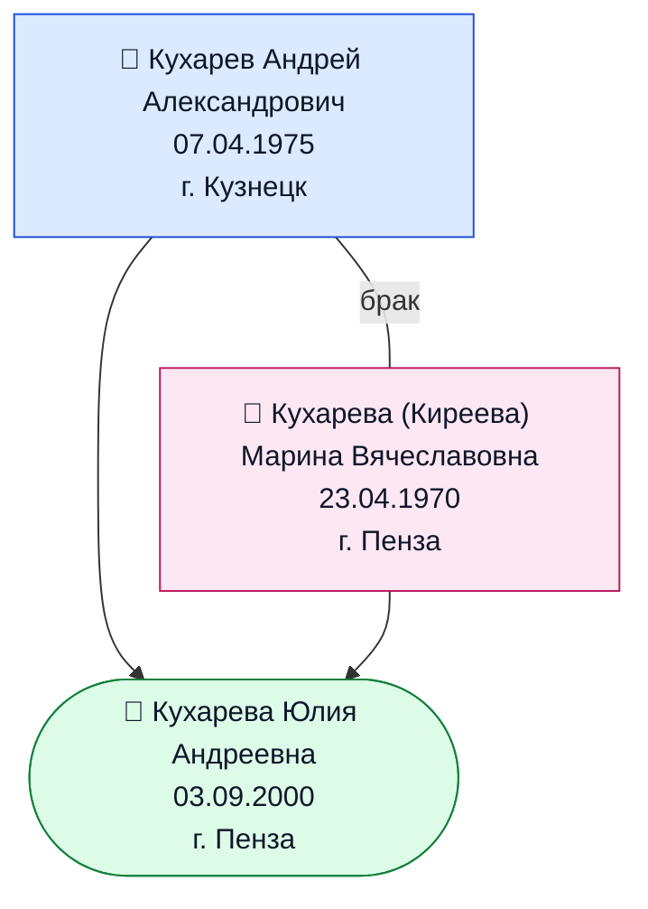

# Родословное древо семьи Кухаревых

## Члены семьи

| Поколение | ФИО | Родство | Дата рождения | Место рождения |
|---|---|---|---|---|
| I | Кухарев Андрей Александрович | отец | 07.04.1975 | г. Кузнецк (Пензенская обл.) |
| I | Кухарева (урожд. Киреева) Марина Вячеславовна | мать | 23.04.1970 | г. Пенза |
| II | Кухарева Юлия Андреевна | дочь | 03.09.2000 | г. Пенза |

## Что уже известно о предыдущих поколениях (из отчеств)

По отчествам можно восстановить имена бабушек/дедушек по мужской линии:

| Поколение | Кто | Что известно |
|---|---|---|
| 0 | Дедушка по отцу | **Кухарев Александр** — отец Андрея Александровича |
| 0 | Бабушка по отцу | неизвестно |
| 0 | Дедушка по матери | **Киреев Вячеслав** — отец Марины Вячеславовны |
| 0 | Бабушка по матери | неизвестно |

## Как дополнить древо

Чтобы расширить древо, пригодятся:

- ФИО, даты и места рождения бабушек и дедушек (отчества дедушек дадут имена прадедушек);
- братья и сёстры родителей, их супруги и дети (дяди, тёти, двоюродные);
- даты свадеб и смерти, если есть;
- архивы для поиска: ЗАГС и Государственный архив Пензенской области, сайты «Память народа» и «ОБД Мемориал» (для предков — участников войны).
